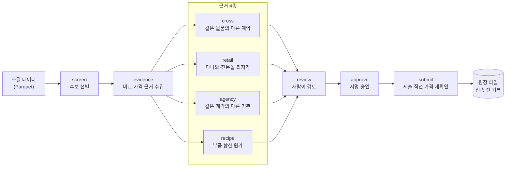

# SaveTax

**나라장터 납품 데이터에서 시중가보다 비싸게 산 물품을 찾아, 근거를 모아 대회 제보까지 이어 주는 감사 도구**

[](./pyproject.toml) [](./src/savetax/dataset.py) [](./pyproject.toml) [](./tests/unit)

## 🧭 개요

**나라장터 해커톤**은 개혁신당과 이준석 의원이 연 대회로, 나라장터 공개 자료를 분석해 시중가보다 과하게 집행된 금액을 찾아 제출하는 방식입니다. 접수 기간은 2026년 10월 12일부터 25일까지였고, 공식 사이트에는 참가자가 1,169명으로 표시되어 있습니다([공식 사이트](https://savetax.now/)). 최종 결과는 근거 확인과 이의 처리를 거쳐 2026년 11월 9일 시상식에서 발표되었습니다([최종 결과](https://hackathon.savetax.now/close-notice/results.html)).

제가 푼 문제는 두 가지였습니다.

- 조달 데이터는 **같은 주문이 여러 물품에 중복으로 붙어 있어**, 그대로 더하면 금액이 부풀려집니다.
- 대회 제보에는 **시중가 근거**가 필요한데, 공공기관 전용 모델은 시중에 같은 제품이 없고, 제보 횟수에도 제한이 있어 실수로 중복 제출하면 안 됩니다.

SaveTax는 후보 물품을 고르고, 네 가지 방식으로 비교 가격 근거를 모으고, 사람이 승인한 뒤에만 제출합니다.

## 🏗️ 시스템 구성



- 명령은 `screen`, `evidence`, `review`, `approve`, `submit`이 기본 흐름이고, 이미 낸 건을 다루는 `status`, `revise`, `withdraw`, `remediate`가 있습니다([CLI](./src/savetax/cli.py)).
- 실행 의존성은 DuckDB 하나이고, 나머지는 표준 라이브러리로 구현했습니다([pyproject.toml](./pyproject.toml)).

## 🔧 핵심 설계 결정

각 결정을 **문제 → 분석(대안 비교) → 선택 → 결과** 순서로 정리했습니다.

### 🧮 1. 중복 주문을 한 번만 세기

- **문제:** 같은 주문 기록(`dlv_key`)이 여러 물품 아래에 반복해서 나와, 단순 합계가 실제보다 큽니다. 대회 데이터 안내에 약 24% 부풀려진다고 적혀 있습니다([규칙 문서](./.agents/rules/domain.md)).
- **분석:** 합계를 계산하기 전에 중복을 없애는 방법이 필요합니다. 다만 중복으로 묶은 기록끼리 계약번호나 금액이 다르면 합쳐서는 안 됩니다. 주문이 없는 물품(약 71%)은 값이 비어 있는 것이지 0이 아니라서, 0으로 채우면 평균이 왜곡됩니다.
- **선택:** 데이터를 불러올 때 `dlv_key`별로 계약번호·금액이 하나로 일치하는지 검사하고, 다르면 오류로 멈춥니다. 비어 있는 값은 0으로 바꾸지 않습니다([데이터셋](./src/savetax/dataset.py)).
- ✅ **결과:** 주문당 한 건으로 집계하는 정규화 뷰를 쓰고, 불일치 데이터는 조용히 넘기지 않고 중단됩니다.

### 🔎 2. 근거를 4가지로 나눈 이유

- **문제:** 시중 쇼핑몰 가격 하나만으로는 후보를 놓치거나, 반대로 잘못 비교한 후보를 제보할 위험이 있습니다.
- **분석:** 같은 물품이 다른 계약에서 더 싸게 팔린 경우, 다른 기관이 같은 계약 단가로 받은 경우, 시중 쇼핑몰 최저가가 있는 경우, 시중에 없는 전용 모델은 부품값을 합쳐 추정해야 하는 경우가 서로 다릅니다. 하나로 합치면 기준(배율)을 한 가지로 정해야 해서 맞지 않았습니다.
- **선택:** 근거를 `cross`, `retail`, `agency`, `recipe` 4종으로 나누고, 종류마다 기준 배율을 설정으로 따로 둡니다. 기본값은 cross·agency·recipe 1.20배, retail 1.10배입니다([설정](./src/savetax/config.py)).
- ✅ **결과:** 근거 종류별 모듈로 분리했고, 기준값이 코드에 흩어지지 않고 타입이 있는 설정 한곳에 모여 있습니다.

### 🧩 3. 시중에 없는 전용 모델은 부품값을 합산

- **문제:** 데스크톱 PC, 패치패널, 서버랙 같은 품목은 공공기관 전용 모델명이라 쇼핑몰에서 같은 제품을 찾을 수 없습니다.
- **분석:** 같은 모델이 없으면 "동급 사양의 부품 가격 합계"로 대신 비교할 수 있습니다. 대신 근거가 약해 보일 수 있으므로, 어느 쇼핑몰 어느 페이지에서 가져온 값인지 제보에 그대로 남겨야 합니다.
- **선택:** CPU·메모리·SSD 같은 사양을 정리해 시판 부품 가격을 합산하고, 설치 공임이 필요한 품목은 표준품셈의 공임을 더합니다([레시피](./src/savetax/recipe.py), [데스크톱](./src/savetax/desktoprecipe.py), [설비](./src/savetax/fixturerecipe.py)). 부품마다 다른 쇼핑몰 두 곳을 근거로 두고, 기준가 대비 1.2~1.3배 구간의 품목은 두 번째 쇼핑몰 가격으로도 확인합니다.
- ✅ **결과:** 레시피 부품 정의는 32개이고, 쇼핑몰 검색 규칙은 18곳입니다([설정](./src/savetax/config.py)). 제보 본문에 출처 페이지와 합산식이 들어갑니다.

### 🚧 4. 잘못된 비교를 막는 문턱

- **문제:** 한 계약 안에 단가가 다른 옵션(저가 옵션, 일반형·내진형)이 섞여 있으면, 비싼 본품을 싼 옵션과 비교해 허위 후보가 나옵니다.
- **분석:** 옵션 단가를 평균 내거나 가장 낮은 값을 쓰면 과다 집행처럼 보이는 후보가 늘어납니다. 반대로 가장 높은 값을 기준으로 삼으면 후보가 줄어도 오탐은 줄어듭니다.
- **선택:** 옵션이 여럿이면 가장 높은 대표 단가를 기준으로 하고([옵션 정책](./src/savetax/variants.py)), 순번 블록이 다른 계열끼리는 비교하지 않습니다([계열 분리](./src/savetax/series.py)). 비교 단가가 납품일에 유효했는지는 변경계약일과 납품 이력으로 확인합니다([단가 시점 증명](./src/savetax/priceproof.py)).
- ✅ **결과:** 오탐을 줄이는 쪽(후보를 덜 내는 쪽)으로 설계했습니다. 각 문턱은 단위 테스트로 확인합니다.

### 🔒 5. 제출은 사람 승인 뒤에, 기록은 전송 전에

- **문제:** 제보 횟수에 한도가 있어, 네트워크가 끊긴 뒤 다시 실행하면 같은 건이 두 번 차감될 수 있습니다. 또 참가자 토큰이 로그나 리다이렉트로 새면 안 됩니다.
- **분석:** 전송 후에 기록하면 "보냈는데 기록이 없는" 상태가 생깁니다. 반대로 전송 전에 기록하면 "기록은 있는데 보냈는지 모르는" 상태가 생기지만, 이 경우는 재실행 때 서버에 조회해 확인할 수 있어 복구가 가능합니다.
- **선택:** 전송 전에 요청 고유 키를 원장 파일에 먼저 쓰고(`flock`으로 잠그고 `fsync`로 디스크에 반영), 재실행 시 미결 건을 확인합니다([원장](./src/savetax/ledger.py), [제출기](./src/savetax/submissions.py)). 승인은 제출 내용의 SHA-256 해시에 묶어 내용이 바뀌면 무효가 됩니다([승인](./src/savetax/approval.py)). 제출 직전에 쇼핑몰 가격을 다시 확인하고([사전 검증](./src/savetax/workflow.py)), 보류가 연속되면 중단하는 옵션이 있습니다. 토큰은 공식 호스트 외로 보내지 않고, 리다이렉트는 따라가지 않으며, 로그에서는 가립니다([HTTP](./src/savetax/http.py), [마스킹](./src/savetax/redaction.py)).
- ✅ **결과:** 재실행해도 같은 건을 다시 보내지 않는 구조이고, 이 경로들은 단위 테스트가 있습니다.

## 🏆 대회 결과

| 항목 | 내용 |
| :--- | :--- |
| 최종 순위 | 45위 (참가자 1,169명 중, 확정 금액이 있는 115명 중 45위) |
| 확정 인정 금액 | 5억 9,274만 6,086원 (대회 전체 확정 1,587.7억 원의 약 0.37%) |
| 상금(세전) | 37,000원 |

출처는 [공식 최종 결과 페이지](https://hackathon.savetax.now/close-notice/results.html)입니다. 확정 금액이 있는 참가자는 115명입니다.

## 📊 개발 지표

| 항목 | 내용 | 측정 기준 |
| :--- | :--- | :--- |
| 테스트 | 1,513개 (테스트 파일 49개) | `pytest --collect-only` 수집 결과 |
| 정적 검사 | mypy strict, ruff 규칙 15개 묶음 | [pyproject.toml](./pyproject.toml) 설정 |
| 소스 규모 | `src/savetax` 약 1.2만 줄 | 소스 파일 줄 수 합계 |
| 통합 검사 | 린트, 타입, 테스트, 변경분 커버리지 | [tools/verify.py](./tools/verify.py) |

## ⚠️ 한계

- **데이터와 토큰이 저장소에 없습니다.** 조달 데이터(`data/`)는 커밋하지 않았고 참가자 토큰이 있어야 하므로, 저장소만으로는 CLI를 처음부터 끝까지 재현할 수 없습니다. 테스트는 합성 데이터로 돌아갑니다.
- 후보의 "과다 집행" 판정은 **시중가와의 비교 추정**입니다. 대회 심사에서 근거 부족으로 인정되지 않을 수 있고, 제 제출 기록상 접수 금액은 약 13.7억 원, 확정 금액은 5.93억 원이었습니다.
- **착수 시점이 순위에 영향을 줍니다.** 다른 참가자가 먼저 제보하기 전에 가격 차이가 큰 물품을 찾는 속도가 중요한 대회였고, 개발과 분석을 더 일찍 시작해야 했다는 점을 배웠습니다.
- 쇼핑몰 가격은 수집 시점의 값이라 시간이 지나면 달라집니다. 이를 줄이려고 제출 직전에 다시 확인합니다.
- 쇼핑몰 페이지 구조가 바뀌면 파서가 깨질 수 있습니다.
- 이 도구는 이번 대회의 규칙과 데이터 형식에 맞춰져 있습니다.

## 🧱 기술 스택

| 구분 | 사용 기술 |
| :--- | :--- |
| 언어 | Python 3.11 |
| 데이터 | DuckDB(Parquet을 DB 서버 없이 직접 조회) |
| 숫자 계산 | `Decimal`(부동소수점 오차 방지) |
| 품질 | pytest, pytest-xdist, mypy(strict), ruff |
| 패키지 관리 | uv |

## 📂 프로젝트 구조

```text
src/savetax/
├── cli.py                          # 명령 진입점
├── dataset.py                      # Parquet 로드, 중복 주문 정리
├── screening.py                    # 후보 선별
├── crosscontract.py                # 근거 cross: 다른 계약의 같은 물품
├── retail.py / shops.py            # 근거 retail: 다나와·전문몰 최저가
├── agencylane.py                   # 근거 agency: 같은 계약의 다른 기관
├── recipe.py                       # 근거 recipe: 부품 합산 원가
├── desktoprecipe.py / fixturerecipe.py   # 품목별 레시피
├── variants.py / series.py / units.py    # 오비교 방지, 단위 정리
├── audit.py                        # Decimal 금액 계산
├── workflow.py / approval.py       # 제출 전 검증, 승인
├── ledger.py / submissions.py      # 원장, 제출
├── http.py / writehttp.py / redaction.py   # 통신, 토큰 보호
└── remediation.py                  # 제출한 건의 사후 정리
tests/unit/                          # 단위 테스트
tools/verify.py                      # 린트·타입·테스트 통합 실행
```

## 🚀 시작하기

의존성은 `uv`로 설치합니다. 테스트는 데이터와 토큰 없이 실행됩니다.

```bash
uv sync --all-extras
uv run pytest -q                  # 단위 테스트
uv run python tools/verify.py     # 린트 + 타입 + 테스트
```

실제 CLI(`screen` 등)를 쓰려면 대회 데이터 Parquet과 참가자 토큰(환경변수 또는 `.env`)이 필요합니다. 토큰은 저장소에 두지 않습니다.

```bash
uv run savetax screen --batch 0
uv run savetax evidence --lane all --items <물품번호> --out-dir scratch/bundle
```

## 🤖 개발 과정에서의 AI 활용

AI 도구는 주로 코드를 쓰는 데 사용했고, 아이디어와 조달 분야 지식을 익히는 데도 썼습니다. **수치와 동작은 직접 확인했습니다.**

| AI에 맡긴 일 | 직접 한 일 |
| :--- | :--- |
| 코드 작성 | 설계 방향과 비교 기준 정하기 |
| 아이디어 정리, 도메인 학습 보조 | 수치와 동작 결과 확인 |

## 📚 참고

- [나라장터 해커톤 공식 사이트](https://savetax.now/)
