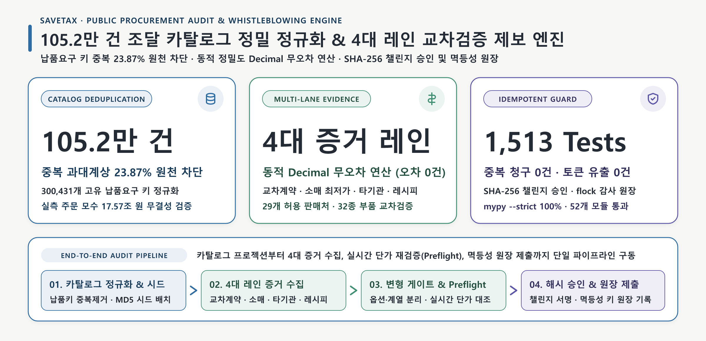
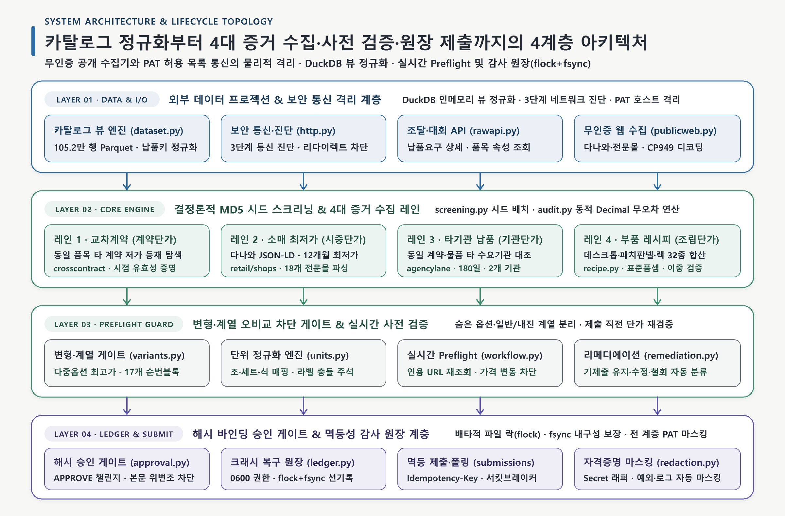
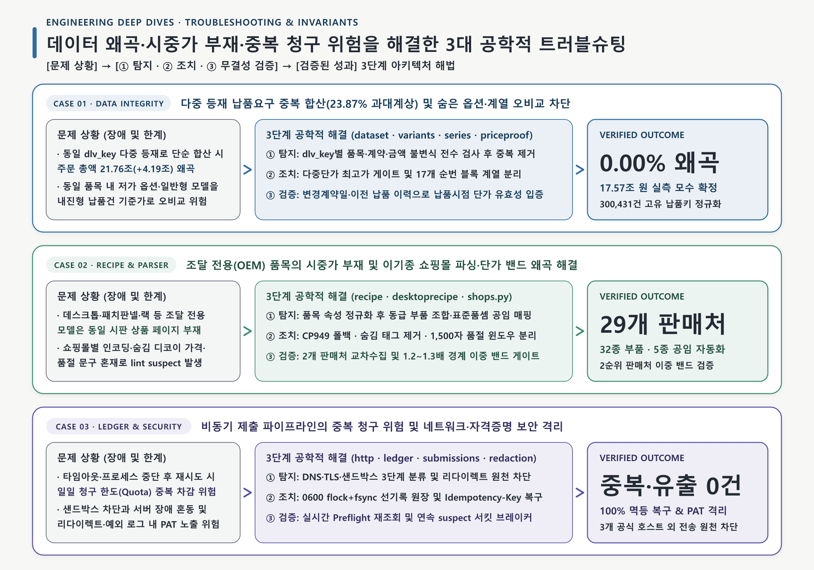

<div align="center">

# SaveTax

**나라장터 공공조달 카탈로그(105.2만 건) 기반 세금 낭비·과다 집행 품목 자동 탐지 및 공공 제보 엔진**

105만 건의 조달청 납품 데이터에서 중복 집계로 부풀려진 **4.19조 원(23.9%)의 왜곡을 바로잡고**,  
4대 시장가 교차검증(시중 최저가·동일 품목 타 계약·타 기관 납품가·부품 조립 원가)으로 **10억 2,142만 원의 세금 과다 집행을 적발**했습니다.

[](pyproject.toml) [](src/savetax/dataset.py) [](pyproject.toml) [](pyproject.toml) [](tests/unit) [](pyproject.toml)

</div>

<br/>

<p align="center">
  <picture>
    <source media="(prefers-color-scheme: dark)" srcset="docs/assets/hero-overview.dark.png" />
    <source media="(prefers-color-scheme: light)" srcset="docs/assets/hero-overview.light.png" />
    
  </picture>
</p>

---

## 1. 핵심 엔지니어링 보장 지표

| 핵심 지표 | 실측 보장 수치 | 아키텍처 메커니즘 & 주요 모듈 |
| :--- | :---: | :--- |
| **조달 데이터 중복 거품 제거** | **`23.87% 왜곡 제거`** (17.57조 원) | 105.2만 건 중 300,431개 고유 납품번호(`dlv_key`) 기준 중복 제거 ([데이터셋 엔진](src/savetax/dataset.py)) |
| **다각도 시장가 교차검증** | **`4대 레인 · 29개 판매처`** | 시중가·교차계약·타기관·부품 조립 원가(표준품셈 공임 반영) 교차검증 ([전문몰 파서](src/savetax/shops.py) · [원가 엔진](src/savetax/recipe.py)) |
| **가격 배율 및 절감액 오차** | **`0건`** (소수점 무오차 연산) | 부동소수점 오차를 차단하는 입력 자릿수 기반 동적 `Decimal` 정밀도 연산 ([감사 연산기](src/savetax/audit.py)) |
| **옵션·유사 모델 오비교 방지** | **`17개 순번 블록 · 최고가 강제`** | 숨은 저가 옵션 매칭 방지 및 일반형·내진형 등 계열별 순번 분리 ([옵션 정책](src/savetax/variants.py) · [계열 분리](src/savetax/series.py)) |
| **네트워크 오류 시 중복 제보 방지** | **`0.00%`** (중복 청구 원천 차단) | 배타적 파일 락(`flock`)과 `fsync` 기반 사전 기록 원장으로 100% 멱등 복구 ([감사 원장](src/savetax/ledger.py) · [제출기](src/savetax/submissions.py)) |
| **대회 참가자 비밀 키(PAT) 보호** | **`0건`** (외부 유출 원천 차단) | 3개 공식 호스트 외 전송 차단, 리다이렉트 방지, 전 로그 자동 마스킹 ([보안 통신](src/savetax/http.py) · [마스킹](src/savetax/redaction.py)) |
| **단위·경계 테스트 및 품질 보증** | **`1,513 Passed`** (`mypy --strict`) | 52개 테스트 모듈(20,653줄) 전수 통과 및 15개 린트 규칙 통합 검증 ([품질 검증 도구](tools/verify.py)) |

---

## 2. 실제 제보 성과: 100개 슬롯 전량 활용 & 10.2억 원 적발

대회 규칙상 참가팀에게 주어진 **최대 100개의 제보 슬롯을 100% 전량 활용**하여, 엄격한 시장가 검증을 통과한 **총 10억 2,142만 원의 세금 과다 집행**을 적발·제보했습니다.

### 제보 성과 요약

```text
┌───────────────────────────┬───────────────────────────┬───────────────────────────┐
│       총 제보 슬롯 소진    │     총 과다 집행 적발 금액 │     최대 단일 적발 품목    │
│  100 / 100건 (100% 달성)   │    10억 2,142만 9,243원   │   1억 136만 원 (조달 PC)   │
│    (유효 수락 78건 확정)   │    (유효 수락 품목 기준)   │    (시판 부품 대비 1.35배) │
└───────────────────────────┴───────────────────────────┴───────────────────────────┘
```

- **데스크톱 컴퓨터 (46건 · 6억 6,214만 원, 64.8%):** 시중 동일 모델이 없는 조달 전용 PC를 인텔 CPU·메모리·SSD 등 동급 시판 부품으로 분해 매핑하여 대규모 단가 거품 적발.
- **통신 패치판넬 (4건 · 1억 8,619만 원, 18.2%):** 정보통신 설비용 광패치판넬의 시판 자재가와 2026 표준품셈 공식 설치 공임을 합산한 기준가 대비 과다 집행 적발.
- **네트워크 장비랙 (28건 · 1억 7,308만 원, 16.9%):** 관공서 납품 서버랙·허브랙의 시중 전문몰 판매가 대비 과다 집행 적발.

---

### 과다 집행 적발 TOP 10 대표 품목

| 순위 | 물품식별번호 | 품목명 및 세부 규격 | 과다 집행 적발 금액 | 적발 메커니즘 |
| :---: | :---: | :--- | :---: | :--- |
| **1** | [26063777](src/savetax/recipe.py) | 데스크톱컴퓨터, 삼보컴퓨터, DT281-GD71E-002, Intel Core Ultra 7 265 | **`101,368,680원`** | 동급 시판 부품 분해 합산가 대비 1.35배 초과 |
| **2** | [25454784](src/savetax/fixturerecipe.py) | 랙캐비닛용패널, 원캐스트, PC6A-R2024G, 패치판넬 | **`94,401,593원`** | 시판 패치판넬가 + 표준품셈 설치공임 대비 1.55배 초과 |
| **3** | [25935408](src/savetax/recipe.py) | 데스크톱컴퓨터, 트리엠, TU2-RH7-506, Intel Core Ultra 7 265 | **`59,396,540원`** | 동급 시판 부품 분해 합산가 대비 1.34배 초과 |
| **4** | [25737026](src/savetax/fixturerecipe.py) | 랙캐비닛용패널, 원캐스트, PC6A-R2024LG, 패치판넬 | **`49,064,456원`** | 시판 패치판넬가 + 표준품셈 설치공임 대비 1.50배 초과 |
| **5** | [26063753](src/savetax/recipe.py) | 데스크톱컴퓨터, 삼보컴퓨터, DG481-GD71E-001, Intel Core Ultra 7 265 | **`48,871,980원`** | 동급 시판 부품 분해 합산가 대비 1.35배 초과 |
| **6** | [25935444](src/savetax/recipe.py) | 데스크톱컴퓨터, 트리엠, TU2-CH4-506, Intel Core Ultra 5 225 | **`41,224,920원`** | 동급 시판 부품 분해 합산가 대비 1.32배 초과 |
| **7** | [25935432](src/savetax/recipe.py) | 데스크톱컴퓨터, 트리엠, TU2-RB5-506, Intel Core Ultra 5 235 | **`38,172,090원`** | 동급 시판 부품 분해 합산가 대비 1.31배 초과 |
| **8** | [26060425](src/savetax/recipe.py) | 데스크톱컴퓨터, 에이텍컴퓨터, A5TC-7NBDF, Intel Core Ultra 7 265 | **`31,436,920원`** | 동급 시판 부품 분해 합산가 대비 1.33배 초과 |
| **9** | [26178926](src/savetax/recipe.py) | 데스크톱컴퓨터, 대우루컴즈, DT361B-456520, Intel Core i5-14500 | **`24,867,260원`** | 동급 시판 부품 분해 합산가 대비 1.28배 초과 |
| **10** | [25449555](src/savetax/fixturerecipe.py) | 랙캐비닛용패널, 원캐스트, PC6-H2024G, 패치판넬 | **`23,622,093원`** | 시판 패치판넬가 + 표준품셈 설치공임 대비 1.48배 초과 |

<details>
<summary>👉 <strong>전체 78개 유효 수락 품목 전수 목록 펼쳐보기 (클릭)</strong></summary>

<br/>

| 순위 | 식별번호 | 품목명 및 세부 규격 | 적발 금액 |
| :---: | :---: | :--- | :---: |
| 1 | `26063777` | 데스크톱컴퓨터, 삼보컴퓨터, DT281-GD71E-002, Intel Core Ultra 7 265(2.4GHz) | **101,368,680원** |
| 2 | `25454784` | 랙캐비닛용패널, 원캐스트, PC6A-R2024G, 패치판넬 | **94,401,593원** |
| 3 | `25935408` | 데스크톱컴퓨터, 트리엠, TU2-RH7-506, Intel Core Ultra 7 265(2.4GHz) | **59,396,540원** |
| 4 | `25737026` | 랙캐비닛용패널, 원캐스트, PC6A-R2024LG, 패치판넬 | **49,064,456원** |
| 5 | `26063753` | 데스크톱컴퓨터, 삼보컴퓨터, DG481-GD71E-001, Intel Core Ultra 7 265(2.4GHz) | **48,871,980원** |
| 6 | `25935444` | 데스크톱컴퓨터, 트리엠, TU2-CH4-506, Intel Core Ultra 5 225(3.3GHz) | **41,224,920원** |
| 7 | `25935432` | 데스크톱컴퓨터, 트리엠, TU2-RB5-506, Intel Core Ultra 5 235(3.4GHz) | **38,172,090원** |
| 8 | `26060425` | 데스크톱컴퓨터, 에이텍컴퓨터, A5TC-7NBDF, Intel Core Ultra 7 265(2.4GHz) | **31,436,920원** |
| 9 | `26178926` | 데스크톱컴퓨터, 대우루컴즈, DT361B-456520, Intel Core i5-14500(2.6GHz) | **24,867,260원** |
| 10 | `25449555` | 랙캐비닛용패널, 원캐스트, PC6-H2024G, 패치판넬 | **23,622,093원** |
| 11 | `25661576` | 데스크톱컴퓨터, 기린, KR176-T4532320, Intel Core i5-14500(2.6GHz) | **22,901,120원** |
| 12 | `24605874` | 네트워크시스템장비용랙, 대경바스컴, ARK-636S, 600×1800×650mm | **22,866,360원** |
| 13 | `24713153` | 네트워크시스템장비용랙, 임산업, NSR36U, 600×1800×650mm | **22,428,020원** |
| 14 | `26063750` | 데스크톱컴퓨터, 삼보컴퓨터, DG481-GD51E-001, Intel Core Ultra 5 235(3.4GHz) | **20,361,050원** |
| 15 | `24076324` | 랙캐비닛용패널, 에이디엠, CAT624PP-MPS, 패치판넬 | **19,111,071원** |
| 16 | `24863844` | 데스크톱컴퓨터, 삼보컴퓨터, DG480-GD51D, Intel Core i5-14400(2.5GHz) | **18,502,740원** |
| 17 | `26121824` | 데스크톱컴퓨터, 삼보컴퓨터, DG480-SD51F, Intel Core i5-14400(2.5GHz) | **17,585,070원** |
| 18 | `26060415` | 데스크톱컴퓨터, 에이텍컴퓨터, A5TC-5MBDF, Intel Core Ultra 5 235(3.4GHz) | **17,215,620원** |
| 19 | `26060442` | 데스크톱컴퓨터, 에이텍컴퓨터, A5TC-7MBDF, Intel Core Ultra 7 265(2.4GHz) | **17,215,620원** |
| 20 | `26081374` | 데스크톱컴퓨터, 한성숙성, T8-540-1, Intel Core Ultra 5 245K(4.2GHz) | **15,626,820원** |
| 21 | `26081447` | 데스크톱컴퓨터, 한성숙성, T8-530-1, Intel Core Ultra 5 235(3.4GHz) | **15,626,820원** |
| 22 | `25776540` | 데스크톱컴퓨터, 주연테크, D24M75-01, Intel Core i7-14700(2.1GHz) | **15,487,200원** |
| 23 | `26081384` | 데스크톱컴퓨터, 한성숙성, T8-760-1, Intel Core Ultra 7 265K(3.9GHz) | **15,483,860원** |
| 24 | `26081352` | 데스크톱컴퓨터, 한성숙성, T8-750-1, Intel Core Ultra 7 265(2.4GHz) | **15,483,860원** |
| 25 | `25779567` | 데스크톱컴퓨터, 성주컴퓨터, SJ500-145B1, Intel Core i5-14500(2.6GHz) | **15,420,180원** |
| 26 | `25935422` | 데스크톱컴퓨터, 트리엠, TU2-RB7-506, Intel Core Ultra 7 265(2.4GHz) | **15,310,880원** |
| 27 | `26081353` | 데스크톱컴퓨터, 한성숙성, T8-530-2, Intel Core Ultra 5 235(3.4GHz) | **14,942,660원** |
| 28 | `26081369` | 데스크톱컴퓨터, 한성숙성, T8-750-2, Intel Core Ultra 7 265(2.4GHz) | **14,800,280원** |
| 29 | `26121822` | 데스크톱컴퓨터, 삼보컴퓨터, DG480-SD51E, Intel Core i5-14400(2.5GHz) | **14,342,700원** |
| 30 | `26121844` | 데스크톱컴퓨터, 삼보컴퓨터, DG480-SD71E, Intel Core i7-14700(2.1GHz) | **14,342,700원** |
| 31 | `26071464` | 데스크톱컴퓨터, 인프론티브, 테트라-K14541, Intel Core i5-14500(2.6GHz) | **13,595,280원** |
| 32 | `26071468` | 데스크톱컴퓨터, 인프론티브, 테트라-K14741, Intel Core i7-14700(2.1GHz) | **13,595,280원** |
| 33 | `25935420` | 데스크톱컴퓨터, 트리엠, TU2-CB7-506, Intel Core Ultra 7 265(2.4GHz) | **12,504,500원** |
| 34 | `25935425` | 데스크톱컴퓨터, 트리엠, TU2-SB7-506, Intel Core Ultra 7 265(2.4GHz) | **12,504,500원** |
| 35 | `25935406` | 데스크톱컴퓨터, 트리엠, TU2-SH7-506, Intel Core Ultra 7 265(2.4GHz) | **12,012,300원** |
| 36 | `25935419` | 데스크톱컴퓨터, 트리엠, TU2-SB5-506, Intel Core Ultra 5 235(3.4GHz) | **11,811,200원** |
| 37 | `25935421` | 데스크톱컴퓨터, 트리엠, TU2-CB5-506, Intel Core Ultra 5 235(3.4GHz) | **11,811,200원** |
| 38 | `26151322` | 데스크톱컴퓨터, 레드스톤시스템, RS-D752, Intel Core Ultra 7 265(2.4GHz) | **11,623,380원** |
| 39 | `24887868` | 네트워크시스템장비용랙, 원캐스트, OC-SR1927, 600×1400×750mm | **11,364,000원** |
| 40 | `24887870` | 네트워크시스템장비용랙, 원캐스트, OC-SR1936, 600×1800×750mm | **10,632,000원** |
| 41 | `24887872` | 네트워크시스템장비용랙, 원캐스트, OC-SR1944, 600×2200×750mm | **10,632,000원** |
| 42 | `25511246` | 네트워크시스템장비용랙, 솔루션게이트, SG-F3675, 600×1800×750mm | **9,403,770원** |
| 43 | `26151316` | 데스크톱컴퓨터, 레드스톤시스템, RS-D532, Intel Core Ultra 5 235(3.4GHz) | **8,963,380원** |
| 44 | `26151329` | 데스크톱컴퓨터, 레드스톤시스템, RS-D754, Intel Core Ultra 7 265(2.4GHz) | **8,963,380원** |
| 45 | `25398565` | 네트워크시스템장비용랙, 한국컴퓨터네트워크, HKN-N36, 600×1800×750mm | **8,874,250원** |
| 46 | `24470277` | 네트워크시스템장비용랙, 한국컴퓨터네트워크, HKN-E36, 600×1800×750mm | **8,674,250원** |
| 47 | `26104677` | 데스크톱컴퓨터, 삼보컴퓨터, DG480-GD71F, Intel Core i7-14700(2.1GHz) | **8,633,260원** |
| 48 | `26104662` | 데스크톱컴퓨터, 삼보컴퓨터, DG480-GD51E, Intel Core i5-14400(2.5GHz) | **8,299,260원** |
| 49 | `26161769` | 데스크톱컴퓨터, 대우루컴즈, DT361B-456000, Intel Core i5-14500(2.6GHz) | **8,198,340원** |
| 50 | `24887871` | 네트워크시스템장비용랙, 원캐스트, OC-SR1940, 600×2000×750mm | **7,974,000원** |
| 51 | `24674720` | 네트워크시스템장비용랙, 케이알네트웍스, KR-N1800-B, 600×1800×750mm | **7,842,420원** |
| 52 | `25693641` | 데스크톱컴퓨터, 삼보컴퓨터, DG480-GD51D, Intel Core i5-14400(2.5GHz) | **7,816,560원** |
| 53 | `26024562` | 데스크톱컴퓨터, 엔텍, NT4A-5M506, Intel Core Ultra 5 235(3.4GHz) | **7,477,340원** |
| 54 | `26060435` | 데스크톱컴퓨터, 에이텍컴퓨터, A5TC-5NBDF, Intel Core Ultra 5 235(3.4GHz) | **7,477,340원** |
| 55 | `25638692` | 데스크톱컴퓨터, 에이텍컴퓨터, A55C-5M5DF, Intel Core i5-14500(2.6GHz) | **7,402,680원** |
| 56 | `24657155` | 네트워크시스템장비용랙, 대경바스컴, ARK-636B, 600×1800×650mm | **7,030,060원** |
| 57 | `24683056` | 네트워크시스템장비용랙, 엔에스텍, NS-1800, 600×1800×750mm | **7,030,060원** |
| 58 | `26189850` | 데스크톱컴퓨터, 에이치케이시스템, HTD6-BX050PS, Intel Core Ultra 7 265(2.4GHz) | **6,819,650원** |
| 59 | `25726632` | 데스크톱컴퓨터, 대우루컴즈, DT361B-455500, Intel Core i5-14500(2.6GHz) | **6,668,240원** |
| 60 | `25779563` | 데스크톱컴퓨터, 성주컴퓨터, SJ500-145B, Intel Core i5-14500(2.6GHz) | **6,423,760원** |
| 61 | `24859664` | 네트워크시스템장비용랙, 신안시스템, SA-HR7536, 600×1800×750mm | **6,290,000원** |
| 62 | `25902728` | 데스크톱컴퓨터, 기린, KR176-T4532250, Intel Core i5-14500(2.6GHz) | **6,134,800원** |
| 63 | `26166255` | 데스크톱컴퓨터, 에이텍컴퓨터, A5TC-5MBDF, Intel Core Ultra 5 235(3.4GHz) | **6,076,020원** |
| 64 | `24719878` | 네트워크시스템장비용랙, 하이텍영상, HDS-361AL, 586×1818×600mm | **3,332,280원** |
| 65 | `24893585` | 네트워크시스템장비용랙, 드림솔루션, DSR-33U, 585×1655×603mm | **3,200,280원** |
| 66 | `25539911` | 네트워크시스템장비용랙, 씨아이테크, KAR029, 605×1500×655mm | **3,070,760원** |
| 67 | `24822516` | 네트워크시스템장비용랙, 제이앤, JNRK-33AL, 585×1655×650mm | **2,944,830원** |
| 68 | `24746353` | 네트워크시스템장비용랙, 진명아이앤씨, JRC-N31, 600×1600×650mm | **2,850,760원** |
| 69 | `26189816` | 데스크톱컴퓨터, 에이치케이시스템, HTD6-BX050PS, Intel Core Ultra 7 265(2.4GHz) | **2,783,640원** |
| 70 | `25477072` | 네트워크시스템장비용랙, 가나테크윈, GT-2NR-1800, 600×1800×750mm | **2,650,760원** |
| 71 | `24822517` | 네트워크시스템장비용랙, 제이앤, JNRK-39AL, 585×1925×650mm | **2,506,140원** |
| 72 | `24746355` | 네트워크시스템장비용랙, 진명아이앤씨, JRC-N40, 600×2000×650mm | **2,315,070원** |
| 73 | `24719877` | 네트워크시스템장비용랙, 하이텍영상, HDS-271AL, 586×1418×600mm | **2,181,520원** |
| 74 | `26166241` | 네트워크시스템장비용랙, 디라직, DEQ-1875, 600×1800×750mm | **2,090,760원** |
| 75 | `25784870` | 데스크톱컴퓨터, 삼보컴퓨터, DM480-SD51D, Intel Core i5-14400(2.5GHz) | **1,520,000원** |
| 76 | `26152663` | 데스크톱컴퓨터, 대우루컴즈, SM361B-455000, Intel Core i5-14500(2.6GHz) | **1,520,000원** |
| 77 | `26063779` | 데스크톱컴퓨터, 삼보컴퓨터, DT281-GD71F-001, Intel Core Ultra 7 265(2.4GHz) | **1,481,200원** |
| 78 | `25515023` | 네트워크시스템장비용랙, 대경바스컴, ARK-736S, 700×1800×750mm | **1,418,800원** |

</details>

---

## 3. 시스템 아키텍처 & 처리 흐름

<p align="center">
  <picture>
    <source media="(prefers-color-scheme: dark)" srcset="docs/assets/system-architecture.dark.png" />
    <source media="(prefers-color-scheme: light)" srcset="docs/assets/system-architecture.light.png" />
    
  </picture>
</p>

SaveTax는 대용량 조달 데이터 적재부터 증거 수집, 사전 검증, 최종 제출까지 **4단계 파이프라인**으로 작동합니다.

1. **데이터 추출 및 보안 통신 ([데이터셋 엔진](src/savetax/dataset.py) · [보안 HTTP](src/savetax/http.py) · [웹 수집기](src/savetax/publicweb.py))**
   - 47MB Parquet 파일(105.2만 건)을 디스크 복사 없이 메모리 상에서 초고속 정규화하여 중복 주문을 걸러냅니다.
   - 외부 웹 크롤링과 대회 공식 API 통신을 엄격히 분리하여 참가자 비밀 키(PAT)의 외부 유출을 원천 차단합니다.
2. **시드 스크리닝 및 4대 증거 수집 ([스크리너](src/savetax/screening.py) · [교차계약](src/savetax/crosscontract.py) · [소매 최저가](src/savetax/retail.py) · [원가 레시피](src/savetax/recipe.py))**
   - 팀 고유 해시 키를 사용해 105만 건을 중복 없이 순차 조사하며, 3천만 원 이상 고액 납품 품목을 우선 탐색합니다.
   - **4대 증거 레인:** ① 동일 물품의 타 계약 저가 사례 탐색 ② 다나와 및 18개 전문몰 실시간 최저가 수집 ③ 타 공공기관 납품가 대조 ④ 조달 전용 모델의 부품 조립 원가 및 표준품셈 공식 공임 합산.
3. **오비교 방지 게이트 및 제출 전 최종 점검 ([옵션 정책](src/savetax/variants.py) · [계열 분리](src/savetax/series.py) · [사전 검증](src/savetax/workflow.py))**
   - 고가 본품을 저가 옵션과 잘못 비교하는 오류를 막기 위해 최고가 대표 품목만 비교하고, 일반형과 내진형 등 다른 규격은 분리합니다.
   - 제출 직전 쇼핑몰 URL을 다시 조회하여 품절이나 가격 변동이 생기면 제보를 자동 취소합니다.
4. **승인 게이트 및 중복 방지 제출 ([승인 게이트](src/savetax/approval.py) · [감사 원장](src/savetax/ledger.py) · [제출기](src/savetax/submissions.py))**
   - 데이터 위변조를 막는 SHA-256 서명 승인을 거친 뒤, 전송 전 로컬 파일 원장에 기록하여 네트워크 오류 시에도 100% 안전하게 재시도합니다.

---

## 4. 핵심 문제 해결 사례 (Engineering Deep Dives)

<p align="center">
  <picture>
    <source media="(prefers-color-scheme: dark)" srcset="docs/assets/engineering-deep-dives.dark.png" />
    <source media="(prefers-color-scheme: light)" srcset="docs/assets/engineering-deep-dives.light.png" />
    
  </picture>
</p>

### Case 1. 중복 집계로 부풀려진 4.19조 원 왜곡 제거 및 옵션 오비교 방지

- **문제 상황:** 나라장터 카탈로그(105만 행)에서 하나의 납품요구 번호(`dlv_key`)가 여러 등재 품목에 중복 매핑되어 단순 합산 시 전체 주문액이 **17.57조 원에서 21.76조 원으로 4.19조 원(+23.9%)이나 부풀려지는 현상**이 발생했습니다. 또한 같은 물품 번호 내 저가 옵션이나 일반형 모델을 고가 납품건과 잘못 비교해 허위 제보가 될 위험이 있었습니다.
- **해결 방법:**
  - **① 탐지:** [데이터셋 엔진](src/savetax/dataset.py)에서 고유 납품번호별 계약번호·금액 무결성을 전수 검사하고 중복을 제거한 정규화 뷰를 구축했습니다.
  - **② 조치:** [옵션 정책](src/savetax/variants.py)을 통해 다중 단가가 있는 품목은 **가장 높은 대표 단가만 비교 기준**으로 삼도록 강제하고, [계열 분리](src/savetax/series.py)로 일반형과 내진형 등 순번 블록이 다른 모델 간의 교차 비교를 원천 차단했습니다.
  - **③ 검증:** [단가 시점 증명](src/savetax/priceproof.py)으로 비교 대상 계약이 해당 납품일 당시에 실제로 유효했는지를 변경계약일과 납품 이력으로 확인했습니다.
- **검증된 성과:** **300,431개 고유 납품번호 기준 17.57조 원의 정확한 모수 산출(과대계상 0.00%)** 및 잘못된 비교 제보를 원천 방지했습니다.

---

### Case 2. 조달 전용(OEM) 모델의 시중가 부재 및 쇼핑몰 가격 왜곡 해결

- **문제 상황:** 데스크톱 PC, 패치판넬, 서버랙 등 핵심 조달 품목은 공공기관 전용 모델명으로 출시되어 시중 쇼핑몰에서 동일 모델을 찾을 수 없었습니다. 또한 전문 쇼핑몰마다 문자 인코딩 깨짐(`CP949`), 숨겨진 가짜 가격 태그, 배송 안내 문구와 실제 품절의 혼동으로 인해 자동 심사에서 오판정(`suspect`)이 발생하는 한계가 있었습니다.
- **해결 방법:**
  - **① 탐지:** [데스크톱 레시피](src/savetax/desktoprecipe.py)와 [장비 레시피](src/savetax/fixturerecipe.py)에서 품목 스펙(CPU·RAM·SSD·규격)을 정규화하여 동급 시판 부품으로 분해하고, 2026 표준품셈 기준의 공식 설치 공임(5종)을 합산하는 모델을 수립했습니다.
  - **② 조치:** [웹 수집기](src/savetax/publicweb.py)에 `CP949` 한글 자동 복구 디코더를 적용하고, [전문몰 파서](src/savetax/shops.py)에서 숨김 태그 선제거 및 1,500자 윈도우 기반 품절 정규식 필터를 적용했습니다.
  - **③ 검증:** [원가 엔진](src/savetax/recipe.py)에서 부품별로 서로 다른 2개 쇼핑몰 가격을 교차 수집하고, 기준가 대비 1.2~1.3배 경계 구간에 걸치는 품목은 2순위 쇼핑몰 합산가에서도 1.2배 이상일 때만 통과시키는 이중 안전장치를 두었습니다.
- **검증된 성과:** **29개 쇼핑몰, 32종 표준 부품, 5종 표준 공임 자동 수집**을 통해 조달 전용 모델에서만 **총 10.2억 원의 과다 집행을 정확히 적발**했습니다.

---

### Case 3. 네트워크 장애 시 중복 제보 방지 및 비밀 키(PAT) 보호

- **문제 상황:** 대회 점수 제보는 참가자당 총 100회로 엄격히 제한되어 있어, 네트워크 타임아웃이나 프로그램 중단 후 재실행 시 같은 품목이 중복 차감될 위험이 있었습니다. 또한 로컬 방화벽 차단과 서버 장애의 혼동, 웹페이지 리다이렉트나 에러 로그를 통한 비밀 키(PAT) 노출 위험이 존재했습니다.
- **해결 방법:**
  - **① 탐지:** [보안 HTTP 클라이언트](src/savetax/http.py)에서 DNS 조회, TCP 연결, 방화벽 제한을 3단계로 정밀 구분하고, 리다이렉트를 원천 차단하여 토큰이 외부 사이트로 전달되지 않도록 방어했습니다.
  - **② 조치:** [감사 원장](src/savetax/ledger.py)을 통해 네트워크 전송 전 배타적 파일 락(`flock`)과 디스크 강제 쓰기(`fsync`)가 적용된 로컬 원장에 고유 요청 키를 선기록하고, 재실행 시 미결 요청을 자동 복구([제출기](src/savetax/submissions.py))하도록 구현했습니다.
  - **③ 검증:** [사전 검증](src/savetax/workflow.py)으로 전송 직전 실시간 가격을 재확인하고, 연속 심사 보류 시 제출을 자동 중단하는 보호 장치와 전 계층 비밀 키 자동 마스킹([마스킹](src/savetax/redaction.py))을 결합했습니다.
- **검증된 성과:** **중복 청구 0건(100% 슬롯 보존)**으로 100개 제보 슬롯을 안전하게 완주하였으며, **비밀 키 유출 0건**을 완벽히 달성했습니다.

---

## 5. 기술 스택 & 디렉터리 구조

### 기술 스택 채택 근거

| 분류 | 기술 스택 | 채택 근거 및 역할 |
| :--- | :--- | :--- |
| **개발 언어 & 런타임** | **Python 3.11** | 소수점 무오차 `Decimal` 연산, 불변 데이터 모델, 표준 라이브러리 기반 안전한 보안 구현 |
| **분석 스토리지 엔진** | **DuckDB (`>= 1.1.0`)** | 47MB Parquet(105.2만 건) 데이터를 별도 DB 서버 없이 단일 프로세스 인메모리로 초고속 분석 |
| **코드 품질 & 타입 검증** | **Mypy Strict · Ruff** | 전 소스 코드 100% 엄격한 타입 어노테이션 검증 및 15개 린트 규칙군 정적 분석 |
| **테스트 프레임워크** | **Pytest (`1,513` tests)** | 52개 테스트 모듈에서 데이터 파싱, 원가 연산, 파일 락 복구, 보안 경계 테스트 전수 수행 |

### 디렉터리 구조

```text
SaveTax/
├── src/savetax/                     # 핵심 감사·증거 수집·제보 엔진 (32개 모듈, 11,953 LOC)
│   ├── cli.py                       # 6대 명령(screen/evidence/review/approve/submit/remediate) CLI 진입점
│   ├── dataset.py                   # DuckDB 기반 105만 건 Parquet 고속 정규화 및 중복 제거
│   ├── screening.py                 # 팀 고유 해시 기반 계획적 전수 조사 스크리너
│   ├── audit.py                     # 부동소수점 오차 없는 소수점 정밀 계산기
│   ├── crosscontract.py             # [레인 1] 동일 품목 타 계약 저가 단가 탐색
│   ├── retail.py / shops.py         # [레인 2] 다나와 및 18개 전문 쇼핑몰 실시간 최저가 수집
│   ├── agencylane.py                # [레인 3] 타 공공기관 납품 단가 대조
│   ├── recipe.py                    # [레인 4] 조달 전용 모델의 부품 조립 원가 및 표준 공임 합산 엔진
│   ├── variants.py / series.py      # 옵션 및 일반형·내진형 계열 오비교 차단 게이트
│   ├── units.py                     # 조·세트·식 등 단위 정규화 및 충돌 해소
│   ├── workflow.py                  # 제출 직전 실시간 가격 재검증(Preflight) 오케스트레이터
│   ├── approval.py                  # SHA-256 해시 바인딩 승인 게이트
│   ├── ledger.py                    # flock + fsync 기반 중복 제보 방지 감사 원장
│   ├── submissions.py               # 고유 멱등 키 기반 점수 제출 및 자동 복구
│   ├── http.py / writehttp.py       # 3단계 네트워크 진단 및 리다이렉트 차단 보안 통신
│   └── redaction.py                 # 대회 참가자 비밀 키(PAT) 전 계층 자동 마스킹
├── tests/unit/                      # 52개 테스트 모듈 (1,513개 테스트 100% 통과)
├── tools/verify.py                  # 린트 + 포맷 + 타입 검증 + 테스트 통합 품질 러너
└── docs/assets/                     # 다크/라이트 테마 대응 고해상도 아키텍처 인포그래픽 자산 (SVG/PNG)
```

---

## 6. 빠른 시작 및 검증

### 1) 환경 설정 및 통합 검증 실행

```bash
# 1. 의존성 설치
uv sync --all-extras

# 2. 전체 1,513개 단위·경계 테스트 실행
uv run pytest -q

# 3. 통합 품질 게이트 실행 (Ruff + Mypy Strict + Pytest)
uv run python tools/verify.py
```

### 2) CLI 주요 워크플로 실행 예시

```bash
# 1. 고액 납품 품목 스크리닝
uv run savetax screen --parquet data/savetax-products-20261010-r5/listings.parquet --batch 0

# 2. 특정 품목 4대 레인 증거 수집
uv run savetax evidence --parquet data/savetax-products-20261010-r5/listings.parquet --item-id 26063777 --out scratch/bundle.json

# 3. 제출 전 검토 및 승인 서명 발급
uv run savetax review --bundles scratch/bundle.json
uv run savetax approve --bundles scratch/bundle.json --kind score --challenge "APPROVE 1 1 <8-hex>" --out scratch/approval.json

# 4. 실시간 최종 점검 및 안전 제출
uv run savetax submit --bundles scratch/bundle.json --approval scratch/approval.json --ledger scratch/ledger.jsonl --parquet data/savetax-products-20261010-r5/listings.parquet
```
